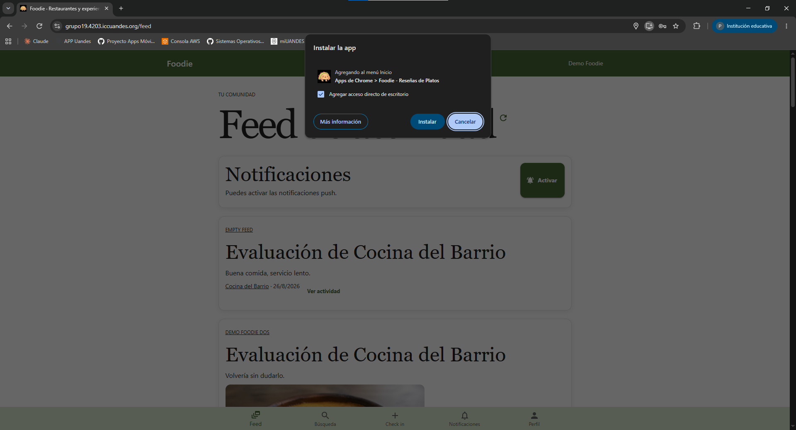
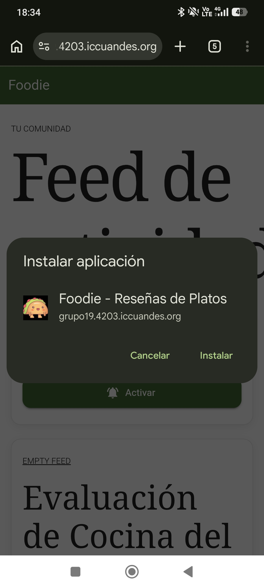
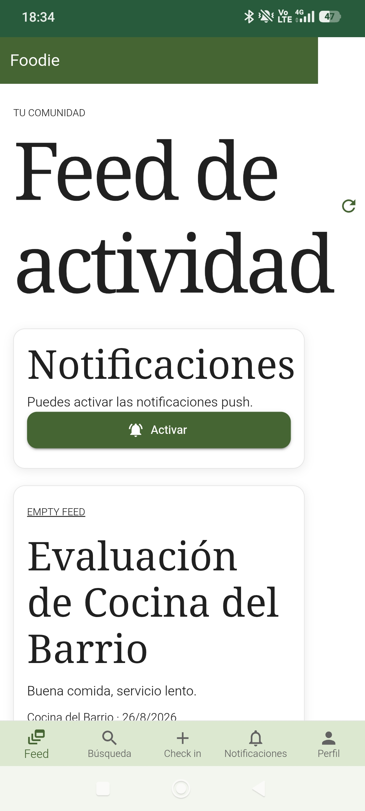
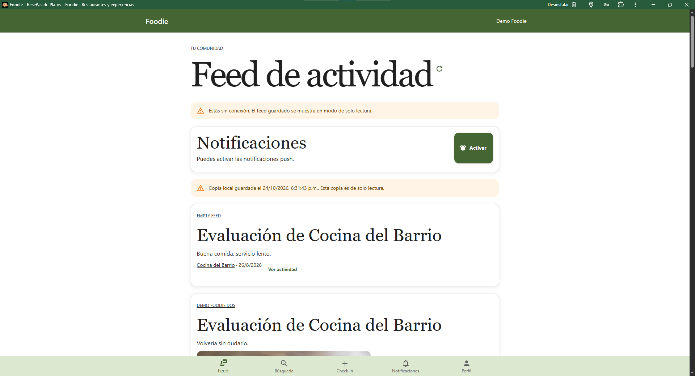
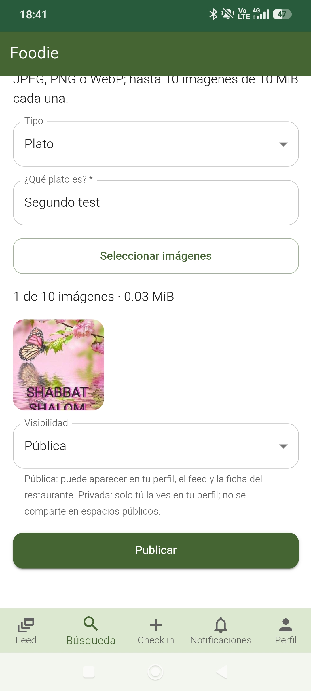
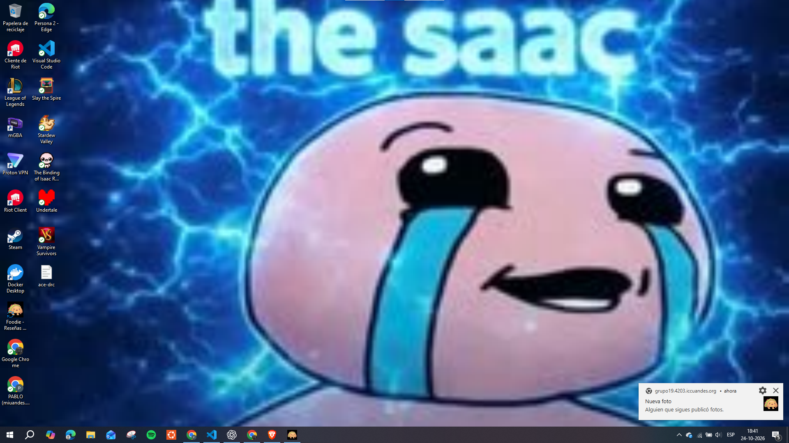
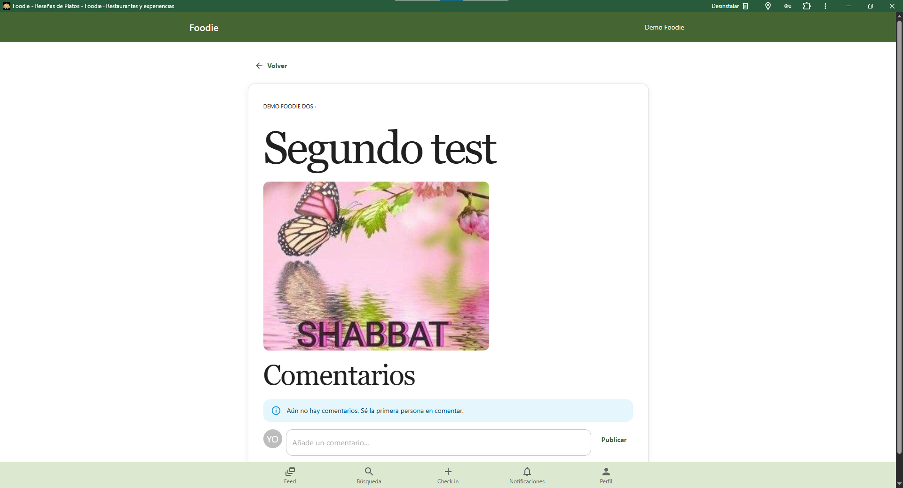

# Informe de Entrega 3 — Foodie

## Aplicación e integrantes

- **Nombre de la aplicación:** Foodie — Reseñas de Platos
- **Integrantes:** Francisco Correa y Pablo Krumenaker
- **Fecha de revisión:** 24 de octubre de 2026
- **Plataforma probada:** Android

## Despliegue y prototipo

- **Aplicación desplegada:** [Foodie — https://grupo19.4203.iccuandes.org](https://grupo19.4203.iccuandes.org)
- **Prototipo de Figma de la Entrega 1:** [Proyecto Apps Móviles](https://www.figma.com/design/QQkmMdfx5sqrGXNd0zAhW9/Proyecto-Apps-Moviles?node-id=14-666&t=s7DZ69UvWdV4uxBu-1)
- **Repositorio del grupo:** [ICC4203-202620/grupo-19](https://github.com/ICC4203-202620/grupo-19)

## Cuentas de demostración

Las siguientes cuentas vienen del seed del proyecto y comparten la contraseña demo-password. La cuenta principal permite probar actividad pública y privada; demo2 permite recorrer actividad social y notificaciones.

| Correo | Handle | Uso |
|---|---|---|
| demo@example.com | @demo | Cuenta principal; sigue a personas y a un restaurante y tiene actividad pública y privada. |
| demo2@example.com | @demo2 | Cuenta seguida por demo; permite comprobar feed y notificaciones entre dos usuarios. |

El seed de demostración debe estar habilitado en el entorno que se evalúa. Estas cuentas son para desarrollo y evaluación; no se deben reutilizar como cuentas reales. Antes de entregar, comprueben que ambas pueden iniciar sesión en el despliegue.

## Instrucciones para ejecutar localmente

### Requisitos

- Git.
- Docker Desktop con Docker Compose.
- Node.js 22.12 o posterior para ejecutar las pruebas y el build del frontend desde el host.
- Una clave de Google Maps para habilitar las funciones cartográficas.
- Claves VAPID para probar Web Push. Sin ellas, el resto de la aplicación puede ejecutarse, pero Push queda desactivado.

### Clonar el repositorio

    git clone https://github.com/ICC4203-202620/grupo-19.git grupo-19
    cd grupo-19

### Configurar Google Maps y Web Push

Crear frontend/.env.local para el build de desarrollo:

    VITE_GOOGLE_MAPS_API_KEY=CLAVE_RESTRINGIDA_PARA_DESARROLLO

La clave VITE se entrega al navegador dentro del bundle. Debe tener restricciones por referente HTTP para localhost y el dominio de despliegue, y limitarse a las API de Maps utilizadas. No debe contenerse en el repositorio. Reinicien Vite o reconstruyan el frontend después de cambiarla.

Para activar Web Push local, crear o completar .env en la raíz:

    VAPID_PUBLIC_KEY=CLAVE_PUBLICA
    VAPID_PRIVATE_KEY=CLAVE_PRIVADA
    VAPID_SUBJECT=mailto:correo-del-equipo@example.com

No versionen .env, frontend/.env.local ni la clave privada VAPID. No definan VAPID_PRIVATE_KEY con prefijo VITE_.

### Iniciar y detener la aplicación

Desde la raíz del repositorio:

    docker compose up --build

Abrir http://localhost:5173. La documentación interactiva del backend se encuentra en http://localhost:5173/docs; el backend también queda disponible directamente en http://localhost:8000 para diagnóstico.

Para detener los servicios conservando la base local:

    Ctrl+C
    docker compose down

No usen docker compose down -v si desean conservar los datos de desarrollo. El seed local crea cuentas de demostración y contenido para recorrer las épicas.

## Instrucciones para desplegar

El despliegue se realiza con el workflow del repositorio descrito en DEPLOY.md. El origen de producción es https://grupo19.4203.iccuandes.org y debe publicarse por HTTPS.

En la configuración del repositorio, en Settings → Secrets and variables → Actions, definan:

**Variables**

- GROUP_ID: 19
- HOST_PORT: 4019
- PUBLIC_ORIGIN: https://grupo19.4203.iccuandes.org
- SEED_DEMO_DATA: true mientras el ayudante necesite cuentas de demostración

**Secretos**

- DATABASE_URL: conexión de PostgreSQL asignada al grupo.
- JWT_SECRET: secreto propio de sesiones, distinto del valor de desarrollo.
- VAPID_PUBLIC_KEY
- VAPID_PRIVATE_KEY
- VAPID_SUBJECT
- VITE_GOOGLE_MAPS_API_KEY: restringida por referente HTTP al dominio del grupo y a localhost.

Después de que termine el workflow, comprobar:

    curl -i https://grupo19.4203.iccuandes.org/healthz
    curl -i https://grupo19.4203.iccuandes.org/manifest.webmanifest

En el navegador, verifiquen que se puede recargar una URL profunda, que el service worker queda registrado con scope /, que la cookie de sesión está marcada Secure y HttpOnly, y que la aplicación se puede instalar como PWA.

## Mapa de las diecisiete épicas

| Épica | Funcionalidad | Ruta de la aplicación |
|---|---|---|
| 1 | Registro e inicio de sesión | /register, /login |
| 2 | Perfil y actividad pública/privada | /profile/:handle |
| 3 | Buscar o crear un restaurante | /explore, /restaurants, /restaurants/new, /restaurants/:id |
| 4 | Explorar restaurantes en el mapa | /explore |
| 5 | Buscar por estilo de comida y cercanía | /explore |
| 6 | Ficha del restaurante | /restaurants/:id |
| 7 | Registrar un check-in | /restaurants/:id/check-in |
| 8 | Publicar una foto de un plato | /restaurants/:id/upload, /photos/:id |
| 9 | Publicar fotos del menú o instalaciones | /restaurants/:id/upload |
| 10 | Reseñar un plato | /photos/:id/review, /reviews/:id |
| 11 | Evaluar un restaurante | /restaurants/:id/evaluate, /evaluations/:id |
| 12 | Buscar usuarios por handle | /notifications |
| 13 | Seguir o dejar de seguir usuarios | /profile/:handle, /notifications |
| 14 | Seguir o dejar de seguir restaurantes | /restaurants/:id |
| 15 | Consultar el feed de actividad | /feed |
| 16 | Ver visitas de personas conocidas | /restaurants/:id, pestaña Personas |
| 17 | Comentar fotografías y responder en threads | /photos/:id |

Las actividades tienen vistas direccionables: visitas en /visits/:id, reseñas en /reviews/:id, evaluaciones en /evaluations/:id y fotografías en /photos/:id. Las reseñas se crean desde /photos/:id/review.

## Decisiones de diseño respecto del prototipo de Figma

El prototipo de la Entrega 1 se usó como guía para la estructura móvil, el orden de navegación, los colores y las tareas principales. La implementación conserva ese flujo, añade las que faltaron en la entrega 1 y adapta algunas pantallas para hacerlas navegables, accesibles y conectadas al backend:

- **De pantallas estáticas a vistas con URL propia.** El prototipo mostraba las pantallas y sus conexiones como un flujo. En React, cada vista principal y cada actividad tiene una ruta direccionable. Esto permite usar el botón de retroceso, compartir un enlace y abrir una actividad desde una notificación.
- **Detalle común para la actividad.** Fotos, reseñas, evaluaciones y visitas tienen rutas propias. Al seleccionar una foto o evaluación se abre su vista detallada. La fotografía pública incluye comentarios y respuestas; las reseñas y evaluaciones muestran su contenido y el restaurante asociado. Esto resuelve la navegación directa que necesita el feed y Web Push.
- **Navegación inferior contextual.** Se mantiene el orden Feed, Búsqueda, Check-in, Notificaciones y Perfil. Check-in solo se habilita desde la ficha del restaurante y lleva al check-in de ese local. En el perfil, el quinto botón pasa a Cerrar sesión. Así se evita habilitar una acción que necesita un restaurante seleccionado.
- **Búsqueda de usuarios dentro de Notificaciones.** Se conserva la ubicación indicada en el prototipo y en las decisiones funcionales del equipo. Los resultados permiten abrir el perfil y seguir o dejar de seguir a la persona.
- **Búsqueda avanzada plegable.** Estilo, radio y ubicación están dentro de una sección que se puede expandir. En una pantalla móvil esto deja la búsqueda por nombre despejada y muestra los filtros cuando se necesitan.
- **Permiso de ubicación explícito.** La aplicación solicita ubicación después de que la persona elige Usar mi ubicación actual. La búsqueda por nombre no depende del permiso y el mapa permite explorar áreas manualmente cuando Maps está configurado. La solicitud explícita hace claro por qué el navegador pide acceso.
- **Formularios adaptados a la API.** El flujo separa publicar la foto del plato de escribir una reseña asociada a ella, y la evaluación permite escoger fotos del menú o instalaciones propias. La separación refleja el contrato del backend y los conceptos de la entrega.
- **Visibilidad explicada en el punto de decisión.** Los formularios explican que la actividad pública puede aparecer en perfil, feed y ficha, mientras que la privada queda visible solo para el propio usuario. La explicación aparece junto al selector para reducir errores de publicación.
- **Adaptación visual funcional, no pixel-perfect.** Las pantallas se construyeron con componentes MUI y se ajustaron a tamaños móviles reales. Se priorizaron jerarquía, consistencia y controles táctiles; no se reprodujeron literalmente todas las medidas ni los placeholders del prototipo.
- **Alcance del backend.** No se agregaron edición de perfil, privacidad de cuenta ni solicitudes para seguir porque el equipo decidió mantener el contrato existente. Son limitaciones del alcance implementado, no pantallas que deban presentarse como terminadas.

## Theme: paleta y tipografía

El theme único está definido en frontend/src/app/theme.js y se aplica desde el punto de entrada de React con ThemeProvider y CssBaseline. Se derivó visualmente de las pantallas de la Entrega 1, que usan fondos claros, encabezados verdes, una barra inferior verde pálido y botones azules.

| Token | Valor | Uso |
|---|---|---|
| Primario | #456633; oscuro #365128; claro #dce8cf | Acciones principales, encabezados y estados asociados a la identidad verde del prototipo. |
| Secundario | #1976d2; oscuro #135eaa; claro #e4f0fc | Acciones secundarias y énfasis azul presente en el prototipo. |
| Fondo | #ffffff | Superficies de página y tarjetas. |
| Texto | #202020; secundario #626262 | Texto principal y texto auxiliar. |
| Divisor | #e2e2e2 | Bordes y separación entre elementos. |
| Error | #7c271d; claro #f6dfda | Errores y mensajes de validación. |
| Éxito | #174b2b; claro #dcebdd | Confirmaciones y estados correctos. |

El texto de cuerpo usa Inter con fuentes de sistema como respaldo. Los encabezados h1, h2 y h3 usan Georgia con Times New Roman como respaldo, para aproximar la jerarquía editorial del diseño. Los botones tienen un alto mínimo de 44 px para interacción táctil y las tarjetas comparten bordes redondeados y elevación discreta.

## Arquitectura del frontend

### Enrutamiento y protección

La aplicación está construida con React 19, Vite, React Router y MUI. frontend/src/main.jsx monta la aplicación, el theme y el contexto de sesión. frontend/src/app/App.jsx declara las rutas y la estructura común, incluida la navegación inferior.

React Router hace que cada vista tenga una URL propia y soporta navegación atrás/adelante del navegador. La ruta inicial redirige según la sesión. Las pantallas de la aplicación están dentro de una zona protegida; las pantallas de inicio de sesión y registro son públicas. El cliente no reemplaza la autorización del servidor: FastAPI sigue validando cada recurso.

### Estado de sesión

frontend/src/app/session-context.jsx mantiene el estado compartido de sesión y el cliente API. Al cargar se consulta la sesión del backend; una respuesta 401 desde cualquier solicitud protegida invalida el estado autenticado y redirige al flujo anónimo. El login se confirma consultando de nuevo la sesión al backend, y logout elimina el estado local, la suscripción de Push de la cuenta y su copia offline.

### Cliente HTTP y obtención de datos

frontend/src/api.js centraliza las solicitudes:

- usa paths relativos /api/v1/... para conservar el mismo origen;
- envía credentials: include para la cookie HttpOnly;
- interpreta errores HTTP y los distingue de fallas de red;
- permite pasar AbortController.signal para cancelar llamadas al cambiar de ruta o desmontar vistas;
- maneja 401 a través del contexto de sesión;
- usa XHR para las cargas de archivos que necesitan informar progreso.

Las pantallas cargan sus datos al activarse y mantienen estados de carga, contenido, vacío y error. Las listas con paginación por cursor solicitan páginas adicionales sin repetir los elementos ya presentados. Los formularios validan datos antes de enviarlos y bloquean el envío duplicado mientras la solicitud está en curso.

### Organización de componentes

App.jsx agrupa vistas y componentes compartidos para el feed, búsqueda, restaurante, perfiles, formularios de actividad y conversaciones. ActivityCard presenta la actividad y sus enlaces; VisibilityField unifica la elección de privacidad; BusyState comunica carga; GoogleRestaurantMap encapsula la carga y eventos del mapa; PushPreferences gestiona la suscripción. CreateRestaurantPage separa el formulario de creación. Las tarjetas, botones, campos, tabs, alertas, listas y selectores usan componentes MUI según su propósito.

El theme se define en un único archivo. La capa de API queda separada de las vistas; el contexto de sesión comparte las capacidades y estado que requieren múltiples pantallas. Esto evita que cada pantalla construya URLs o interprete por separado la cookie de autenticación.

## Service worker y almacén offline después de migrar a React

El service worker de la entrega 2 se adaptó al build de Vite:

- El build genera archivos JavaScript y CSS con hash. frontend/scripts/generate-sw.js recoge los archivos resultantes y crea la lista de precarga; no se mantiene a mano una lista que quedaría desactualizada.
- La instalación precarga el app shell construido y la activación limpia las cachés de versiones anteriores para evitar mezclar recursos de dos builds.
- notificationclick valida que el destino pertenezca al mismo origen. Si ya hay una ventana abierta, envía un mensaje NAVIGATE con postMessage y la enfoca; el listener del cliente entrega la navegación a React Router. Si no hay cliente, abre la ruta de la aplicación.
- Las rutas del frontend son manejadas por React Router, por lo que el gateway de producción debe servir index.html como fallback para rutas profundas.

El almacén de IndexedDB sigue siendo de solo lectura offline y está separado por identificador de usuario. Guarda el snapshot del feed, el cursor y copias de las imágenes descargadas para que el feed pueda consultarse sin conexión. Al iniciar sesión se limpia el contenido perteneciente a otras cuentas; al cerrar sesión se elimina la copia asociada al usuario actual. En modo offline la interfaz identifica el contenido como copia desactualizada y no permite crear o editar datos.

## Integración de Web Push con los destinatarios del backend

El backend contiene la regla de destinatarios en backend/app/services/notifications.py. Para una actividad pública, resuelve los seguidores del autor y del restaurante, excluye al autor y deduplica cada usuario aunque siga ambas entidades. Una actividad privada no genera destinatarios. Esta resolución es interna del servidor y no expone el grafo de seguimientos como endpoint público.

El emisor del grupo está en backend/app/services/push.py. En el arranque de backend/app/main.py se registra send_activity_notification mediante set_notifier. El backend entrega al emisor el tipo de actividad, su identificador y la lista de destinatarios ya resuelta. El emisor consulta push_subscriptions por esos identificadores y llama a pywebpush.webpush una vez por suscripción activa. Si las claves VAPID no están configuradas, no envía Push.

La notificación incluye un título, texto, tipo, id y URL de cliente. Las visitas y evaluaciones abren sus rutas detalladas. Para publicaciones que agrupan varias fotos, abre el feed y destaca la actividad correspondiente. Las reseñas de fotos no disparan una notificación adicional porque la publicación de la foto ya notificó esa entrada de actividad. Por la misma regla, varias fotos cargadas como un acto generan un aviso por entrada del feed, no uno por archivo.

## Evidencias de instalación, modo offline y notificación

Adjuntar aquí capturas o un video breve obtenidos en el despliegue HTTPS. No se deben usar capturas simuladas. Incluir:

1. **PWA instalada:**

2. **Modo offline:**

3. **Notificación dirigida con la aplicación cerrada:**

La revisión visual y funcional debe realizarse con dos cuentas. También conviene registrar la fecha, dispositivo y navegador utilizados.

## Resultado de las pruebas

Los siguientes resultados fueron incorporados desde la ejecución local:

| Comando | Resultado |
|---|---|
| docker compose --profile test up --build --abort-on-container-exit --exit-code-from backend-tests backend-tests | Correcto: 332 pruebas aprobadas, 0 fallidas, 1 advertencia. |
| npm test, desde frontend | Correcto: 23 pruebas aprobadas, 0 fallidas. |
| npm run build, desde frontend | Correcto: build completado en 2,93 segundos; una advertencia por tamaño del bundle JavaScript. |

El build también genera el precache del service worker. Las pruebas automatizadas cubren el cliente HTTP, las transiciones de autenticación y otros comportamientos seleccionados; no sustituyen el recorrido manual de todas las épicas, PWA offline, instalación y notificaciones en el despliegue.

## Problemas conocidos y restricciones

- El contrato actual del backend no ofrece edición de perfil, privacidad de cuenta ni solicitudes para seguir. Se decidió conservar ese contrato.
- El campo para añadir una dirección en búsqueda avanzada no tiene geocodificación. La búsqueda por cercanía depende de la ubicación actual y del permiso del navegador.
- Al mover el mapa después de una búsqueda por cercanía, los resultados del área visible pueden reemplazar la lista que estaba ordenada por distancia. Conviene comprobar el comportamiento con los estilos y el radio seleccionados.
- El formulario de creación existe en /restaurants/new y la lista /restaurants enlaza a él, pero falta un acceso visible desde el estado sin resultados de /explore.
- La paginación está disponible en el feed, búsquedas y conversaciones. El perfil y la ficha del restaurante presentan la primera página de actividad, fotos y evaluaciones, sin controles visibles para pedir más.
- Algunos errores se muestran dentro de la pantalla y el patrón de regresar y mostrar un mensaje flotante no es uniforme.
- Ante un error HTTP de feed distinto de 401, el cliente puede mostrar un snapshot offline incluso si el navegador está conectado; esto puede ocultar un problema del servidor.
- Google Maps requiere una clave válida, con referentes y API habilitada. Geolocalización requiere permiso del usuario y contexto seguro; si se deniega, siguen disponibles búsqueda por nombre y mapa libre.
- Web Push requiere claves VAPID válidas y una suscripción activa. Instalación PWA y permiso Push en producción requieren HTTPS.
- La operación offline es de solo lectura y se limita al feed guardado; no hay escrituras offline ni sincronización en segundo plano.
- El despliegue debe conservar el seed de demostración durante la evaluación y mantener secretos fuera del repositorio y del bundle del cliente.

## Declaración de uso de inteligencia artificial generativa

En el desarrollo y documentación de esta entrega se utilizaron ChatGPT y Codex como asistentes de programación. Se emplearon para apoyar la revisión del código, diagnosticar errores, implementar cambios solicitados y redactar documentación. El equipo revisó el resultado y mantiene la responsabilidad sobre el código, sus decisiones y su explicación ante la evaluación.

